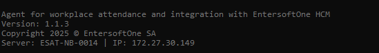
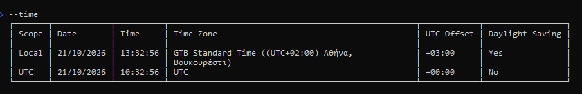
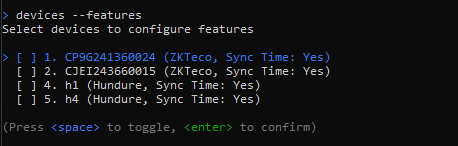
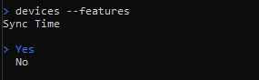
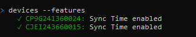
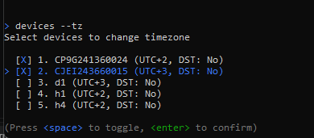
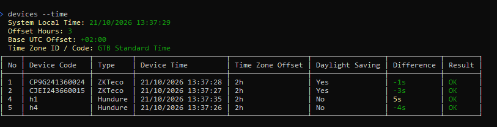

# ES1 Worklife Agent 1.1.3 User Guide



## Application Settings

### ZKTeco settings

ZKTeco settings are stored under `Devices:ZKTeco` in `appsettings.json`. An
environment-specific file such as `appsettings.Production.json` can override these values.
Restart the agent after changing them.

```json
{
	"Devices": {
		"ZKTeco": {
			"EnableListening": true,
			"SetDateHeader": false,
			"IgnoreLastTimeAttendance": false,
			"AttendanceOverlapSeconds": 600,
			"SendTimeZone": 0,
			"ProtVersion": "2.4.2",
			"ServerVer": "2.4.2",
			"ConnectMaxAttempts": 3,
			"ConnectRetryDelayMs": 1000,
			"Timeouts": {
				"ConnectTimeoutMs": 5000,
				"SendTimeoutMs": 5000,
				"CommandTimeoutMs": 5000,
				"BulkPrepareTimeoutMs": 60000,
				"DataTimeoutMs": 30000
			}
		}
	}
}
```

| Setting | Default | Description |
|:---|:---|:---|
| `EnableListening` | `true` | Enables the HTTP endpoints used by the ZKTeco PUSH protocol. Set to `false` when PUSH communication must be disabled. |
| `SetDateHeader` | `false` | When enabled, the ZKTeco controller explicitly sets and logs the UTC HTTP `Date` response header. When disabled, Kestrel manages the standard header. |
| `IgnoreLastTimeAttendance` | `false` | Ignores the stored attendance watermark and reads the complete device attendance buffer. Use temporarily for recovery or diagnostics; full reads increase transfer time and load. Duplicate records are filtered downstream. |
| `AttendanceOverlapSeconds` | `600` | Subtracts this many seconds from the last attendance time before the next read. The overlap protects against small clock differences; duplicate records are filtered downstream. |
| `SendTimeZone` | `0` | Controls whether a `TimeZone` option is sent during PUSH initialization. See the modes below. |
| `ProtVersion` | `"2.4.2"` | Sent to the device as `PushProtVer=<value>` during PUSH initialization. Empty or whitespace-only values omit the option. |
| `ServerVer` | `"2.4.2"` | Sent to the device as `ServerVer=<value>` during PUSH initialization. Empty or whitespace-only values omit the option. |
| `ConnectMaxAttempts` | `3` | Total connection attempts, including the first attempt. Values below `1` are treated as `1`. |
| `ConnectRetryDelayMs` | `1000` | Delay in milliseconds between connection attempts. No delay is added after the final attempt. |

#### SendTimeZone modes

| Value | Name | Initialization behavior |
|:---:|:---|:---|
| `0` | `None` | Does not send a `TimeZone` option. The device keeps its own timezone configuration. This is the default. |
| `1` | `BaseOffset` | Sends the server timezone's base UTC offset, without the current daylight-saving adjustment. |
| `2` | `OffsetHours` | Sends the server's current UTC offset, including daylight saving when active. |
| `3` | `UseDeviceTimeZone` | Sends the registered device's stored `TimeZoneOffset`. The option is omitted if the serial number is not registered. |

For example, a server in `GTB Standard Time` normally has a base offset of `+2` and may
have a current offset of `+3` while daylight saving is active. Mode `1` sends `TimeZone=2`,
while mode `2` sends `TimeZone=3` during that period.

`SendTimeZone` controls the PUSH initialization response only. Device clock synchronization
is a separate operation controlled per device by the `SyncTime` feature and the NTP settings.

#### Protocol version options

During `GET /iclock/cdata?SN=<serial>&options=all`, configured version values produce:

```text
PushProtVer=2.4.2
ServerVer=2.4.2
```

Set either JSON value to an empty string to omit its line:

```json
"ProtVersion": "",
"ServerVer": ""
```

These options are read when the agent starts and are delivered when a device next performs
the initialization handshake. Restart or reconnect the clock if it does not request the new
options automatically.

#### ZKTeco timeouts

All timeout values are milliseconds. Except for `ConnectTimeoutMs`, they are idle timeouts for
one socket send or read, not a maximum duration for the complete operation. A large buffered
attendance transfer can therefore take longer than an individual timeout value.

| Setting | Default | Description |
|:---|---:|:---|
| `ConnectTimeoutMs` | `5000` | Maximum time allowed to establish the TCP connection. |
| `SendTimeoutMs` | `5000` | Maximum wait while sending data to the device. |
| `CommandTimeoutMs` | `5000` | Maximum wait for one small command, such as session setup, counts, time operations, or a user update. |
| `BulkPrepareTimeoutMs` | `60000` | Maximum wait for the device to prepare and acknowledge a buffered read. Devices with large attendance buffers may need more time. |
| `DataTimeoutMs` | `30000` | Maximum wait for the next block during an active buffered read. |

## CLI Commands

The Windows service must be running for commands that call the agent. From an ordinary shell,
prefix examples with `ES1.Worklife.Cli.exe`. In interactive CLI mode, enter the examples as
shown below.

Run this command at any time to see the installed version's options:

```powershell
devices --help
```

### Device identifiers

Commands accept either the number shown by `devices --info` or the exact device ID:

```powershell
devices --show 2
devices --show CJEI243660015
```

The number is a persistent `DeviceNo`; it is not the device's network address.

### Device command reference

| Command | Description |
|:---|:---|
| `devices --info` | Lists all devices with status, connection state, health, type, last ping, user count, and attendance count. |
| `devices --show [<device>]` | Shows one device's configuration, runtime information, ZKTeco command statistics, and effective capabilities. With no device, lists all devices. |
| `devices --new` | Adds a device interactively. The prompts depend on the selected provider type. |
| `devices --state [<device>]` | Changes the connection state. With no device, opens a multi-select list. Active devices can send attendance to HCM; use Test for non-production attendance. |
| `devices --features [<device>]` | Enables or disables automatic `SyncTime` for ZKTeco or Hundure devices. With no device, opens multi-select. |
| `devices --tz [<device>]` | Stores a UTC offset from `-12` through `+14` and a daylight-saving flag. With no device, opens multi-select. |
| `devices --connectmode <device>` | Changes a ZKTeco device between Pull and Push mode. Pull reads records over the device connection; Push accepts uploads initiated by the clock. |
| `devices --start <device>` | Starts attendance collection immediately for one device. |
| `devices --ping <device>` | Tests whether one device is reachable. The operation has a 30-second CLI deadline. |
| `devices --time [<device>]` | Compares device and server time. With no device, checks all ZKTeco and Hundure devices. |
| `devices --synctime <device>` | Immediately synchronizes a supported device with the server's NTP-backed reference time. |
| `devices --users <device>` | Lists users stored on a device and writes a UTF-8 tab-separated export to `data/<device-id>.users.txt`. |
| `devices --syncusers <device>` | Immediately pushes HCM users to one device. The device must be in Active or Test state. |
| `devices --deleteusers [<device>]` | Deletes all users from one device, or opens multi-select when no device is supplied. Requires confirmation and does not delete the device itself. |
| `devices --commands <device> [--top <n>]` | Shows recent queued, sent, succeeded, failed, and expired commands for a ZKTeco device. `--top` defaults to `20`; non-positive values also use `20`. |
| `devices --setlastatt <device>` | Changes the attendance watermark and file position used by the next collection. Use carefully because moving the watermark can reread or skip records. |
| `devices --test [<device>]` | Tests an existing File or Database provider, or starts the interactive provider test when no device is supplied. |
| `devices --delete <device>` | Permanently deletes the device configuration and associated data after confirmation. |

### Server time

Use the root `--time` command to show server local time, UTC time, timezone, current UTC offset,
base UTC offset, and daylight-saving status:

```powershell
--time
```



### Enable or disable time synchronization

Configure one device by number or ID:

```powershell
devices --features 2
```

Omit the device to select multiple ZKTeco or Hundure clocks, then choose whether automatic
time synchronization should be enabled:

```powershell
devices --features
```







Disabling `SyncTime` prevents the monitor from automatically changing that device's clock.
It does not change `Devices:ZKTeco:SendTimeZone`.

### Change a device timezone

```powershell
devices --tz 2
```

The command prompts for a UTC offset and whether daylight saving is active. Omit the device to
apply the same selection to multiple devices. This updates the stored device configuration;
mode `SendTimeZone=3` uses the stored offset in the next ZKTeco PUSH initialization response.



### Inspect and synchronize device time

Show all supported device clocks:

```powershell
devices --time
```

Show one device clock:

```powershell
devices --time 2
```

Synchronize one device immediately:

```powershell
devices --synctime 2
```



### Inspect ZKTeco commands

```powershell
devices --commands 2
devices --commands 2 --top 50
```

The table is ordered newest first and shows creation time, command type, state, command ID, and
description. Use it when diagnosing delayed PUSH commands or failed user updates.

### Safety notes

- Verify the target with `devices --show <device>` before changing state, timezone, attendance watermark, users, or configuration.
- `devices --deleteusers` deletes every enrolled user from the selected clock or clocks.
- `devices --delete` removes the complete device registration and associated data.
- `IgnoreLastTimeAttendance=true` and moving the last-attendance watermark backwards can produce large rereads. Duplicate filtering prevents duplicate events, but transfer and processing load still increase.
- Use `devices --time` after timezone or clock changes to verify the resulting wall-clock time and offset.